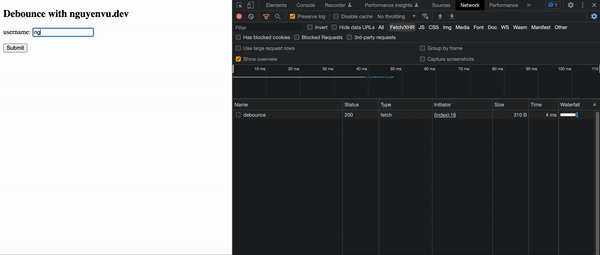
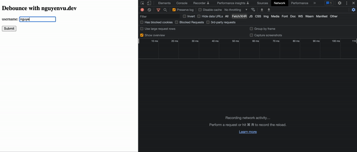

Guten Taggg, long time no see you guys haha. I was too busy to blog more, but today I'm gonna show you how to improve your browser performance with a practice called `debounce`.

Have you ever tackled the challenge that getting all user's inputs and sending them to the server? I'm sure you did! And as many software engineers, I was using the `onChange` event to listen for changes from the user's input.

This led to another problem, if I (as a user) enter a quite long character, then my frontend application will make a ton of API calls. This is a huge problem that gets my server hit soooooo many times (as in the gif below).

<center></center>

## Reducing the frequency of API calls.

Let's have some simple html codes as below:

```html
<!DOCTYPE html>
<html>
  <head>
    <script type="text/javascript">
      window.onload = () => {
        const source = document.getElementById('username');

        source.addEventListener('input', async (e) => {
          const rawResponse = await fetch('http://localhost:8080/debounce', {
            method: 'POST',
            headers: {
              Accept: 'application/json',
              'Content-Type': 'application/json',
            },
            body: JSON.stringify({ username: e.target.value }),
          });
        });
      };
    </script>
    <title>nguyenvu.dev</title>
  </head>
  <body>
    <h2>Debounce with nguyenvu.dev</h2>
    <form>
      <p>
        <label
          >username: <input id="username" type="text" autocomplete="off"
        /></label>
      </p>
      <p>
        <button type="submit">Submit</button>
      </p>
    </form>
  </body>
</html>
```

This is a very simple example of getting users' input right? I'm sure everyone knew it. But at this level of logic, we're calling the API every single time while user's typing.

Let's add a small helper function to `await` while user's typing. For example, let's say _500ms_ (a half of a second) after user finish.

```html
<!DOCTYPE html>
<html>
  <head>
    <script type="text/javascript">
      window.onload = () => {
        const debounce = (func, waitingTime = 100) => {
          let timeout;
          return (...args) => {
            clearTimeout(timeout);
            timeout = setTimeout(() => {
              func.apply(this, args);
            }, waitingTime);
          };
        };

        const source = document.getElementById('username');
        source.addEventListener(
          'input',
          debounce(async (e) => {
            return fetch('http://localhost:8080/debounce', {
              method: 'POST',
              headers: {
                Accept: 'application/json',
                'Content-Type': 'application/json',
              },
              body: JSON.stringify({ username: e.target.value }),
            });
          }, 500)
        );
      };
    </script>
    <title>nguyenvu.dev</title>
  </head>
  <body>
    <h2>Debounce with nguyenvu.dev</h2>
    <form>
      <p>
        <label
          >username: <input id="username" type="text" autocomplete="off"
        /></label>
      </p>
      <p>
        <button type="submit">Submit</button>
      </p>
    </form>
  </body>
</html>
```

## Result.

After implementing the debounce to my API calls, there's only one request is made to the server, this helps to reduce a lot of pressure on the server!!!

<center></center>

## How does the debounce work?

Kinda confusing right? The behind-the-scenes of this practice can be explained as these very simple steps:

- Start the function with timeout === null.
- Every time user enters something, it clears and resets the timeout to `waitingTime`.
- If the `waitingTime` is hit, it will call the original `func`.

That's it!!!

## Conclusion.

Not a really new practice but efficient, I hope that I have at least introduced and explain to you about the debounce practice. I'm going to blog more and more about any interesting things that I tackled.

Many thanks to you for reading until this line haha. See you on the next blog :">
