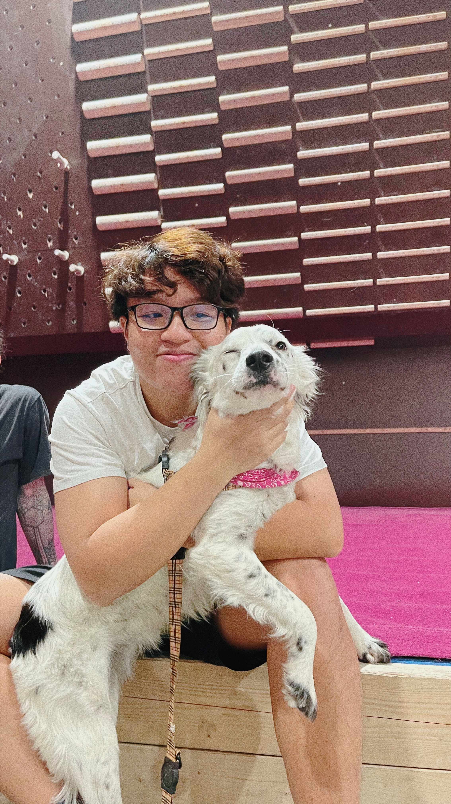
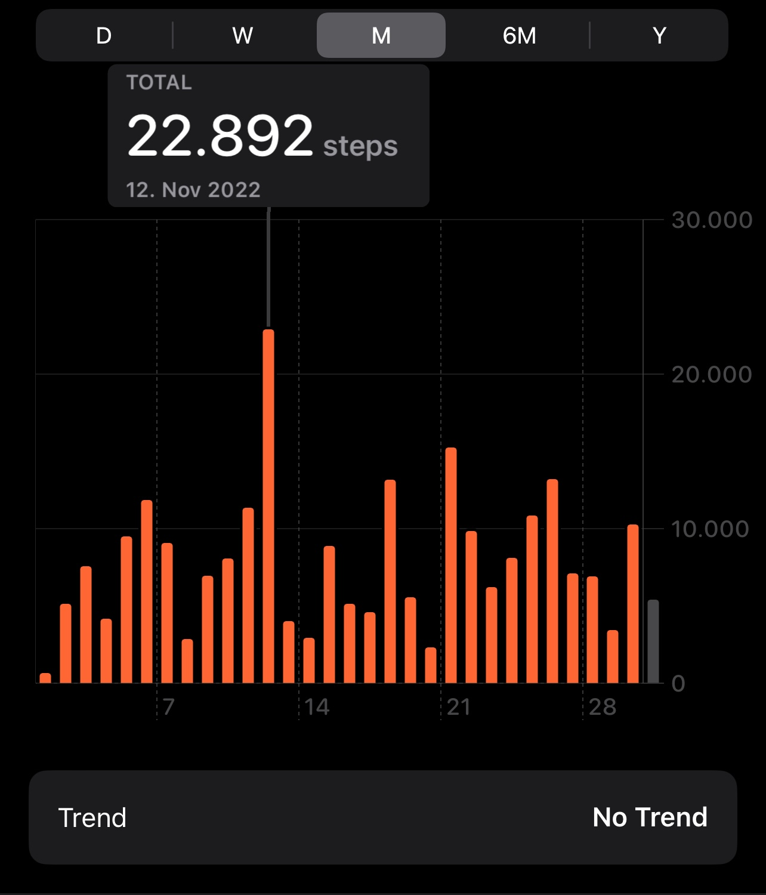
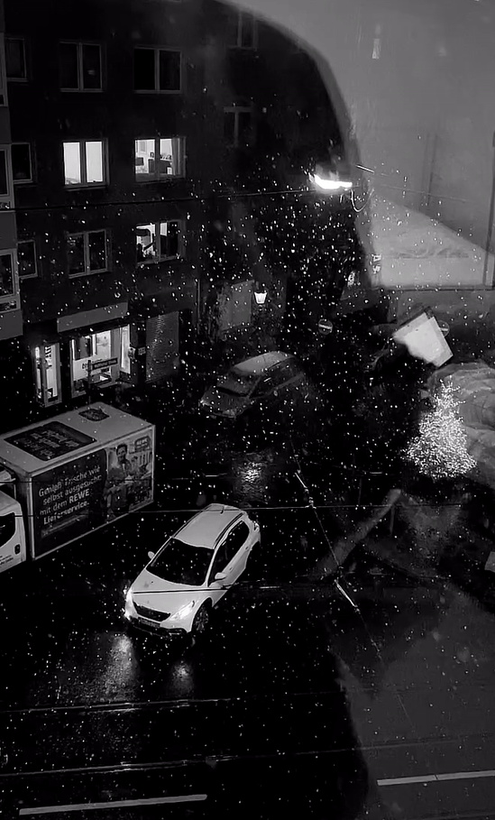

Hey there, all good?
I'm sitting here in my own apartment on the last Sunday of 2022, thinking about what I have done this year, and then it's popping out of this post.

## Looooooot of changes.

I left UMB after nearly one year working there, thanks for all the supportive from team F and my peers.

I finally got my driving license and traveled a lot this year. I went to new cities, and enjoyed different vibes as much as I could.

I took my family on a trip to Da Nang, Hoi An and Hue, we spent a lot of time together, which was pretty great as I want to spend more time with my family before leaving. I also had the experience of hearing the real AK-47 gunfire 🔫🔫🔫 right behind my ass there, you could see more information on [the local post] or [reddit]. 

I also got my German certificates haha. I was a bit worried so I registered for two examinations and passed both of them, the second examination I didn't learn anything but still could make it easily.

I stopped investing in cryptocurrencies for a while. My lesson is that never never never ever buy any currencies developed by Vietnamese =))) They just want to "úp bô" you without making any real impact.

I started working at [retraced], this is also the first time I work in a very international team, everyone speaks english with different accents and it was really hard for me to understand what were they talking about.

I met Bang, another Vietnamese who was working at retraced from the beginning. Together with Bea, we're making impacts on the most important and valuable feature of retraced.

I dyeing my hair for the first time, although my mother told me that she will now allow me to live in my home with that but I'm living another country now mom 🤷‍♂️🤷‍♂️

## I came to Germany!!!
Yep, I made it! I published this blog when I'm in Germany. It has been a year since I started the process to join retraced, everything was a mess at the beginning but I somehow could manage properly.

My friends asked me how does it feel living aboard? Yeah, it's a mess, and quite hard as this is the first time I've been living outside of VietNam. I left everything behind, going to a new country, starting everything from scratch, and doing the paperwork which I couldn't understand without using google translate.

I also found my own apartment, shietttt. This was the hardest thing and also took a loooot of time. But yea, I like my apartment now, cozy and big enough for my lazy ass cuz I don't want to spend so much time cleaning things (I'm still spending roughly two hours cleaning it every weekend TT.TT).

I barely traveled abroad when I was in Vietnam but now I have more opportunities to do that, all I need is to save as much as money I can to spend them sparely.

## But I...

really miss the food in VietNam. There are many Vietnamese restaurants here but the taste are shiett compared to the original one.

cannot play football ⚽️ every weekend with my homies anymore.

cannot go swimming every morning 🏊🏻‍♂️.

cannot just go home and see my family on the weekend as easily as before.

cannot enjoy the sunshine as much as I was in Vietnam and I'm taking Vitamin D tablets.

## Instead I have...

cycling class 🚴🏻‍♂️ every Tuesday, although I skipped it for 2 weeks already 💀

bouldering 🧗🏻 on every Wednesday with my friends and Luna 🐕 the doggie.

badminton on Friday but I'm trying to do it every week 💀

walking 🦶, walking 🦶 and walking 🦶🦶🦶 I'm walking around 8000 steps on average monthly, the highest steps I have reached was 22.892 which is approx. 18km 💀

## Best trade off or?

I counted everything here as the best experience I ever had. Although I felt lonely sometimes, but for me it's ok to feel lonely cuz I'm stepping out of my safety zone and trying new things every day. I mean, how could I see, touch, and taste the snowflake if I kept staying at my home right?
 

That's my 2022, I'm glad that I have done so much. Wish you all the best in 2023 and we'll meet again for more technical blogs 💀💀💀

[the local post]: https://tienphong.vn/doi-tuong-no-sung-cuop-tiem-vang-tai-cho-dong-ba-khai-dong-co-gay-an-post1458963.tpo
[retraced]: https://www.retraced.com/about-us
[reddit]: https://www.reddit.com/r/VietNam/comments/wcrvg7/a_robber_armed_with_an_ak_gun_broke_into_two_gold/